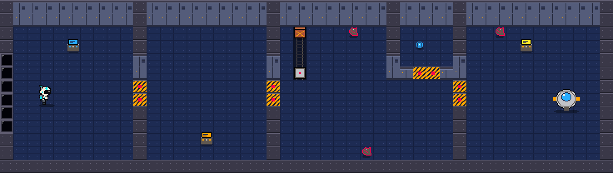

# Back2Earth

*Your spaceship is being pulled toward a black hole. Use its failing gravity to navigate wreckage, work with a damaged AI companion, and launch the last escape pod home.*

UBhacks 2026 · Godot 4 · GDScript · top-down 2D · retro pixel art

> **Starter build status:** every system below is written, and every GDScript file passes a syntax parser. The backend has 12 passing tests. **Nobody has launched this in Godot yet**: the build machine couldn't download Godot. Do the "First launch" check below before anyone branches off.



*Cockpit → Engineering → Cargo (sled channel, core compartment) → Pod Bay, in the 3/4 view. Static preview from `tools/preview_layout.py`, not a Godot screenshot.*

---

## Engine (pinned)

| | |
|---|---|
| Engine | **Godot 4.7.x stable**, standard build (not .NET) |
| Exact patch the team uses | `4.7.__` ← fill this in at hour 0; everyone installs the same one |
| Renderer | Compatibility (works for native + web) |
| Language | GDScript only |

If you open the project in a different version, Godot asks to convert it. Say no and install the pinned version instead.

---

## First launch (5 minutes, do this once)

1. Open Godot 4.7 → **Import** → pick this folder's `project.godot`. The first open imports all PNG/WAV files; wait for it to finish.
2. Watch the **Output** and **Debugger → Errors** panels. They should show no red errors.
3. Press **F5**. The animated title menu plays. Hold the mouse down on each button: it should sink in (the face drops onto its shadow and dims), and act when you let go. Open **How to Play**, **Settings**, and **Credits** (Esc or BACK closes them). Click the speaker icon: a red slash shows it's muted. Then click **Start Game** (or press Enter).
4. The suit picker opens. Each suit card sinks when clicked.
5. Click a suit (click it again, press LAUNCH, or press **E** to start). A/D or ←/→ also choose.
6. Walk to the blue terminal (top of the cockpit) and press **E**. The cockpit door opens and the timer starts. Walk behind the terminal: your astronaut should be hidden behind it, then drawn in front when you walk below it.
7. Run the automated checks from a terminal in this folder:
   ```bash
   godot --headless --path . res://tests/test_runner.tscn
   ```
   It ends with `=== N passed, 0 failed ===`. It plays a full run by script (sled puzzle, core, clamp, pod), restarts 3 times, and exits with the failure count.

If anything errors, paste the exact error into chat (with the file and line) and fix that first.

---

## Controls

| Key | Action |
|---|---|
| WASD / arrows | Move |
| E | Interact (prompt appears only near a valid target; nearest wins) |
| Hold SPACE | Mag-boots: walk 60 px/s, drift only 18 px/s instead of 90 |
| H | Ask ECHO for help |
| Esc / P | Pause (then R restart, M mute, V reduced shake/flash) |
| R | Restart on the end screens |
| A/D or ←/→ | Choose a suit on the picker (E to launch, Esc back to the story) |
| Q | Main menu (from pause, win, lose, or picker; Esc also works on the picker) |
| Menu | Mouse for every button; Enter/E = Start Game, M = mute, Esc = close a panel |

Input actions are registered in code (`scripts/core/input_setup.gd`). If you add an action with the same name in Project Settings → Input Map, yours wins.

---

## How a run plays

```
Title menu ─Start Game─▶ Suit picker ─Launch─▶ run
   ▲                                                                        │
   └──────────── Q from pause / win / lose (R restarts the run) ───────────┘
```

```
Picker ─▶ Cockpit ──▶ Engineering ──▶ Cargo ──────────────▶ Pod Bay ──▶ Earth
              terminal     power console   sled slides on a      clamp,
              (timer       (doors 2 open,  DOWN surge → plate    board pod
              starts)      sled powered)   → compartment → core
```

| # | Objective id | Done by | Opens |
|---|---|---|---|
| 1 | `start_evacuation` | Cockpit terminal `T` | Door `1`, starts the 6:00 timer |
| 2 | `restore_power` | Power console `P` | Door `2`, powers the cargo sled |
| 3 | `open_compartment` | Sled reaches plate `S` during a DOWN pull | Door `K` |
| 4 | `collect_core` | Core `N` (adds `navigation_core`) | Door `3` |
| 5 | `release_clamp` | Clamp console `L` | — |
| 6 | `board_pod` | Pod `O` (needs power + core + clamp) | Win → launch sequence |

**Gravity:** 6 s calm at the start, then repeating **3 s warning → 6 s pull → 7 s calm**, alternating **DOWN, UP**. The HUD shows a blinking amber arrow and frame during the warning, and a red arrow during the pull.

**Failure:** debris contact = −10 s, followed by a 1 s hit cooldown. Reaching 0:00 loses the run.

---

## Who owns what

Plan lanes A–D. Edit your own files; flag a teammate before touching theirs.

```
project.godot                      A   engine/display settings, autoloads
scenes/main.tscn, scripts/main.gd  A   mission root; restart = reload this scene
scripts/core/game_state.gd         A   rules: objectives, timer, damage, win/lose (autoload GameState)
scripts/core/gravity_director.gd   A   surge cycle + drift
scripts/core/input_setup.gd        A   input actions
scenes/player/, scripts/player/    A   movement, boots, interaction targeting, camera

data/ship_layout.txt               B   THE LEVEL: edit the ASCII and press F5 (legend: data/LAYOUT_LEGEND.md)
tools/preview_layout.py            B   re-render docs/map_preview.png after editing the layout
scripts/ship/ship_builder.gd       B   turns the ASCII into walls, doors, objects
scripts/interactables/             B   consoles, sled puzzle, core, pod, doors, debris

scripts/ai/companion_client.gd     C   ECHO client: requests, validation, fallbacks
data/dialogue_fallbacks.json       C   authored ECHO lines (offline mode)
server/                            C   /companion backend (Python stdlib)

scripts/ui/hud.gd                  D   HUD, suit picker, pause, lose/win screens
scripts/ui/press_button.gd         D   panel/picker button that sinks when pressed
tools/extract_menu_buttons.py      D   cuts the painted button faces out of the menu video
scenes/menu.tscn, scripts/ui/main_menu.gd   D   title menu over the menu video
scripts/ui/ui_style.gd             D   shared navy/cyan panel + button style
data/credits.json                  D   names on the CREDITS panel
scripts/core/settings.gd           D   mute, reduced shake (autoload Settings)
scripts/core/sfx.gd                D   sound player (autoload Sfx)
scripts/ship/art.gd                D   palette + texture helpers
assets/, tools/gen_placeholder_assets.py, CREDITS.md   D
art_source/, tools/import_astronaut_skins.py           D   suit drawings -> grid-true sprites
```

---

## Contracts (agree before splitting work)

| Contract | Where |
|---|---|
| `interact(player)` and `can_interact(player)` on every interactable; it asks GameState and never sets state itself | `scripts/interactables/interactable.gd` |
| `GameState.complete_objective(id) -> bool` is idempotent and rejects out-of-order completion | `game_state.gd` |
| Signals `objective_changed(id)`, `inventory_changed()`, `time_changed(seconds)`, `run_ended(won)`, plus `phase_changed`, `damaged`, `room_changed`, `paused_changed`, `game_event(event_id)` | `game_state.gd` |
| `gravity_warning(direction)`, `gravity_changed(direction, drift_speed)`; `get_drift(braced)` | `gravity_director.gd` |
| `GameState.get_canonical()` returns `{id, text, hint}`: the authoritative objective and hint, never from the model | `game_state.gd` |
| Phases: BRIEFING, PLAYING, WON, LOST. Pause stops the countdown and the gravity cycle | `game_state.gd` |
| Launch and timer expiry are validated centrally; after PLAYING ends, damage and launch are ignored | `game_state.gd` |

Restart reloads `scenes/main.tscn`, and `main.gd` calls `GameState.new_run()`. That resets the timer, objectives, sled, doors, debris, hit cooldown, gravity phase, pending dialogue, and run id together.

---

## ECHO (AI companion)

Two separate text channels:

1. **Objective and hint** (top bar). These come from game rules only.
2. **ECHO's caption** (bottom). This is flavor only, and every caption is labeled by source:
   - `ECHO · LIVE`: the model answered.
   - `ECHO · MOCK SERVER`: the server's canned test lines.
   - `ECHO · OFFLINE (scripted line)`: an authored fallback from `data/dialogue_fallbacks.json`.

**Rules (already implemented):** one request in flight; 15 s cooldown; max 12 requests per run; repeated events coalesced within 10 s; 3 s timeout. Pending replies are dropped on objective change, pause, game over, or restart. Replies whose `run_id`, `state_version`, or `event_id` don't match are discarded. Gameplay never waits on a reply.

**Run the backend** (Python 3.10+, no packages needed):

```bash
python3 server/companion_server.py                 # mock mode: no keys, no cost
export GEMINI_API_KEY=...                           # Google Gemini writes ECHO's and the crewmate's lines
export ELEVENLABS_API_KEY=sk_...                    # ElevenLabs speaks the crewmate's lines
python3 server/companion_server.py                 # live mode
python3 -m unittest server/test_companion_server.py
```

Optional environment variables: `GEMINI_MODEL` (default `gemini-3.5-flash-lite`), `NPC_VOICE_ID` (default Katie, `HXrznjtuwc7KlmunddH7`), `ELEVENLABS_MODEL` (`eleven_flash_v2_5`), `TEXT_CALLS_PER_DAY` (3000), `TTS_CHARS_PER_DAY` (40000), `COMPANION_PORT` (8787), `COMPANION_MOCK=1` (force mock). On the hosted server the keys live only in `/etc/back2earth/companion.env`.

The endpoints are public, so the server rate-limits each player and stops calling Gemini/ElevenLabs once a daily budget is used up (the game then falls back to scripted lines).

### Crewmate (talk to an NPC)

Layout char `M` places the surviving crewmate (top-left of the cockpit). Walk up and she says the pre-recorded greeting (`assets/voice/crewmate_greeting.mp3`, works offline). Press **E** to open the chat box, type anything, **Enter** to send, **Esc** to close.

Pipeline: game `POST /npc/talk` (message + last few turns + the canonical objective/hint) → Gemini writes a 1-2 sentence in-character reply → the text shows at once → game `GET /npc/audio/<id>.mp3` → ElevenLabs reads it in Katie's voice (cached on the server and by Cloudflare). If the server is unreachable, she answers with a scripted line built from the real hint. She can't change game state: replies are flavor and paraphrased hints only.

To add another NPC: add an entry to `NPCS` in `server/companion_server.py` (persona prompt + voice id), a script like `scripts/interactables/crewmate.gd` with its `npc_id`, and a layout char in `ship_builder.gd`. To pre-record a scripted line in the same voice, run on the server: `python3 /opt/back2earth/server/companion_server.py --tts "Your line." > line.mp3` (with the env file loaded).

The game posts to `http://127.0.0.1:8787/companion`. With no server running, the HUD shows `ECHO: OFFLINE` and the game is fully playable.

**Request snapshot:** `run_id`, `state_version`, `event_id` (unique, e.g. `help#4`), `room_id`, `objective_id`, `time_band` (`not_started|plenty|ok|low|critical`), `inventory`, `recent_event`, `boots_use_count`, `canonical_hint`.

**Response:** `run_id`, `state_version`, `event_id` (echoed), `line` (≤180 chars, plain text), `source` (`model|mock`). Anything else is rejected and the game shows the fallback.

The API key lives only in the server's environment. Never put it in Godot, the repo, or a web build.

---

## Exporting (D)

1. Install the export templates for the **exact** pinned version (Editor → Manage Export Templates).
2. Project → Export → add your OS (primary deliverable) and optionally Web.
3. **Resources tab → "Filters to export non-resource files"**: add `data/*.txt, data/*.json`.
   Without this, the build can't read the level or ECHO's lines. Both have built-in fallbacks, but edits to the files would be silently ignored.
4. Test the exported build on the demo laptop: sound plays, Wi-Fi off still works, a full run reaches Earth.
5. Web build: ECHO stays offline unless the backend is on HTTPS with CORS. That's fine; it's labeled.

---

## Hosting (web build)

| Address | What | Served by |
|---|---|---|
| `https://back2earth.pp.ua` | The web build | Caddy on the team server, `/var/www/back2earth` |
| `https://www.back2earth.pp.ua` | Redirects to the address above | Caddy |
| `https://api.back2earth.pp.ua/companion` | ECHO backend (web builds call this, see `Settings.WEB_COMPANION_URL`) | Caddy → `back2earth-companion` service on `127.0.0.1:8787` |

Cloudflare proxies all three DNS records (orange cloud), with SSL mode **Full (strict)** and a Cloudflare Origin CA certificate on the server. The server's firewall allows port 443 from Cloudflare's IP ranges only, so it can't be reached directly.

**Redeploy the game:** copy `.env.example` to `.env` (gitignored) and fill in the server login, SSH key path, and Godot path, then run `tools/deploy_web.sh` (exports, gzips the wasm, uploads, swaps in). Ask a teammate for the server details; they are never committed.

**Update the backend:** copy `server/companion_server.py` to `/opt/back2earth/server/` on the server, then `sudo systemctl restart back2earth-companion`. Secrets (e.g. `ANTHROPIC_API_KEY`) go in `/etc/back2earth/companion.env`, never in the repo. The endpoint is public: add rate limiting before switching ECHO to live mode.

---

## View and camera (Stardew-style 3/4)

- **Perspective:** top-down at a 3/4 angle. Walls with floor below them show a **front face**. The back wall is 2 tiles tall (the layout's top two rows). Other walls show their top cap. The rules are in `ShipBuilder.wall_kind()`.
- **Depth:** the ship node has `y_sort_enabled`. The player, consoles, pod, core, sled, and debris are its children and draw in order of their **base** y. Every object's origin is where it touches the floor: the player's feet, a console's front edge. So you walk behind things above you and in front of things below you.
- **Feet collision:** the player collides with an 18×10 box at the feet, so the head can overlap the wall behind, like Stardew. Consoles and the pod have solid footprints.
- **Camera:** smoothly follows the body (`CAMERA_SMOOTHING_SPEED` in `player.gd`) and stops at the map edges. If you see pixel jitter while moving, raise the speed or turn smoothing off there.
- **Shadows:** soft ovals under the player, props, and debris sell the floor plane.
- **Floor:** one continuous surface with no tile grid. `assets/tiles/floor.png` is a 256×256 seamless texture, and each floor cell draws its own slice of it by world position. If you replace it, keep it seamless and a multiple of 32 px.
- **Space window:** the `W` block in the cockpit's back wall is one wide pane. The nebula video plays behind it (`scripts/ship/space_window.gd`). The video is clipped to the glass, loops every 12 s, and shifts slightly as the camera moves (`PARALLAX`). `FOCUS` picks which part of the video is centered at the start of a run. The camera can rise 48 px above the map, so the HUD bar never covers the back wall.

## Suits (skins)

- Four suits: **classic**, **hazard**, **nebula**, **mint**. They are listed in `Settings.SKINS`, and the choice is saved in `user://settings.cfg`.
- **Flow:** menu → suit picker → play. Every new run and restart opens the picker with your last suit selected.
- **Art pipeline:** the original drawings live in `art_source/` (a 4×6 walk sheet and the concept sheet). `python3 tools/import_astronaut_skins.py` snaps them to a true pixel grid and writes:
  - `assets/sprites/astronaut_<suit>.png`: 6 walk frames facing right, each 20×26 art px, saved at 2× (40×52 in-game). Frame 5 is idle; left is a flip.
  - `assets/ui/portrait_<suit>.png`: 16×19 front portrait, shown at 6× on the picker.
- **Adding a suit:** add a row to both source sheets (or drop in the two PNGs), add an entry to `Settings.SKINS`, then re-run the tool.

## Main menu

- `scenes/menu.tscn` + `scripts/ui/main_menu.gd` is the project's main scene. The title and the five buttons are **painted into** `assets/video/menu_loop.ogv`, which loops every 12 s. The script places invisible buttons exactly over the painted ones (`HOTSPOTS`, in 640×360 px). If the video is redrawn, re-measure those rects: take the 1920×1080 frame and divide the pixel coordinates by 3.
- **Press effect:** while a button is held, it's covered with the background color and its face is redrawn lower by the depth of its 3D strip, slightly darker, so it looks pushed in. The face images come from `tools/extract_menu_buttons.py` (`assets/ui/menu_btn_<id>.png`). The action fires on release. There is no hover or selection outline by design.
- **Keys:** Enter/E presses START GAME and M presses the speaker, both with the same sink animation. Esc closes a panel. Panel buttons and suit cards sink the same way when clicked.
- **Buttons:**
  - START GAME fades out and loads the game.
  - HOW TO PLAY shows the goal, steps, and controls.
  - SETTINGS has sound, reduced shake & flash, ECHO live replies, fullscreen, and quit. Fullscreen and quit are hidden on web.
  - CREDITS reads `data/credits.json`. **Put your names in it.**
  - The speaker icon toggles sound.
- Every setting is saved in `user://settings.cfg`.
- **Fallback:** if the video is missing, the menu still works and shows labeled buttons.

## Video

- `art_source/pixel_nebula_loop_1080p.ogv` is the original (Ogg Theora, 1920×1080, 30 fps, 12 s).
- `assets/video/nebula_loop.ogv` is the game copy, re-encoded to 480×270 so each art pixel is 2×2 in-game, like everything else. It is ~16× cheaper to decode, which matters for laptops and web builds. To redo it:
  ```bash
  ffmpeg -i art_source/pixel_nebula_loop_1080p.ogv -vf "scale=480:270:flags=area" -c:v libtheora -q:v 9 -g 30 -an assets/video/nebula_loop.ogv
  ```
- `art_source/menu_loop_1080p.ogv` is the original menu video. `assets/video/menu_loop.ogv` is a 1280×720 re-encode, drawn with smooth filtering because the menu art isn't on the game's pixel grid:
  ```bash
  ffmpeg -i art_source/menu_loop_1080p.ogv -vf "scale=1280:720:flags=lanczos" -c:v libtheora -q:v 6 -g 30 -an assets/video/menu_loop.ogv
  ```
- Godot only plays Ogg Theora (`.ogv`). Convert any MP4/WebM first.

## Art and sound

**One pixel size everywhere:** art is drawn at 16 px per tile and saved at 2×, so one art pixel = 2×2 screen pixels for tiles, props, and suits alike. Placeholders come from `tools/gen_placeholder_assets.py` (PICO-8 palette). To replace one, draw a new file **at the same size** with the same name; collisions never depend on art. See `CREDITS.md`.

Display settings: 640×360 base, `canvas_items` stretch, integer scaling, nearest filtering, 2D pixel snap. Don't rotate sprites (use flip). For a pixel font, add a theme with antialiasing off and log its license in `CREDITS.md`.

---

## Known limitations (be honest in the demo)

- Not yet launched in the Godot editor (see the top of this file).
- Room layout is generated from ASCII at runtime, so the editor's 2D view of `main.tscn` is empty. Run the game to see it.
- The cargo sled ignores the player and the player can't enter its channel. That's deliberate: the sled can't trap anyone.
- Suits only have side-view walk frames; walking up or down keeps the last left/right facing. Front/back frames would be the next art addition.
- Wall faces are drawn on the floor layer, so a wall *below* the player never covers their feet. That's fine for this layout.
- HUD uses Godot's default font until D adds a pixel font.
