<div align="center">

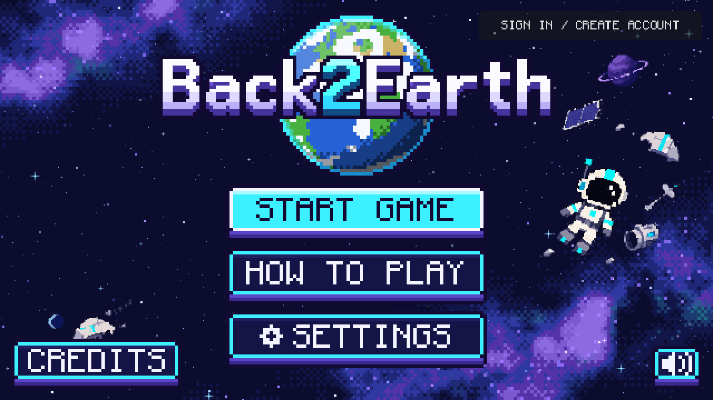

# Back2Earth

**A pixel-art survival escape where your crewmates are AI, and you talk to them out loud.**

Made in 24 hours at **UB Hacking 2026** · Godot 4.7 · Google Gemini · ElevenLabs

### ▶ [Play it in your browser: back2earth.pp.ua](https://back2earth.pp.ua)

*Chrome or Edge recommended for voice chat · keyboard, mouse or controller*

</div>

---

## The story

The repair mission to the Mars station went perfectly. Then, on the way home, debris tears through the *Wayfarer*. Kien is pulled into space, main power dies, and Dhan is pinned under a fallen locker with a broken leg.

You're **Johnny**. The ship is dark, Dhan is getting weaker, and the only way home is the shuttle in the bay. It has no power and is still clamped in. You can't do it alone, so you'll have to talk your crew through it.

<p align="center">
  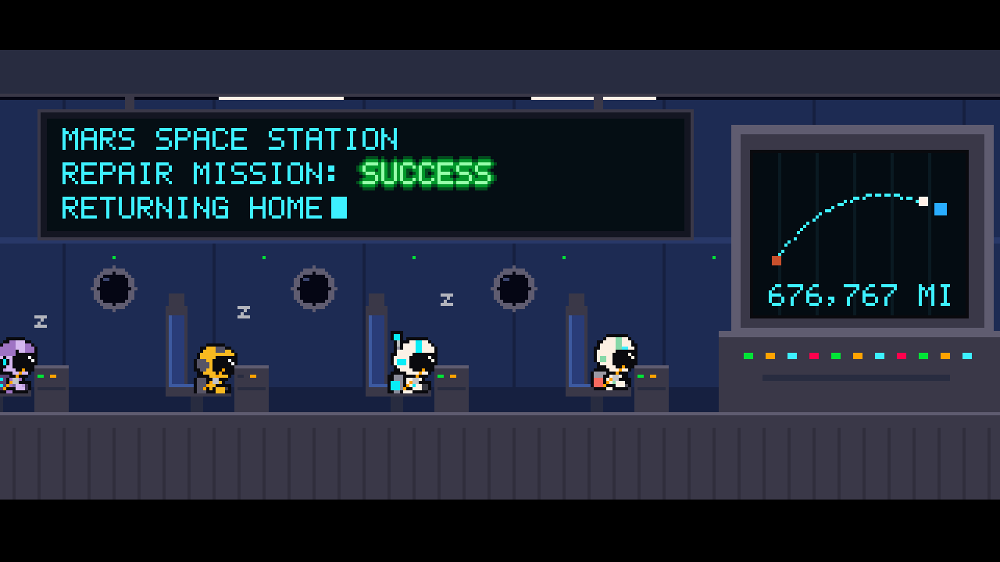
  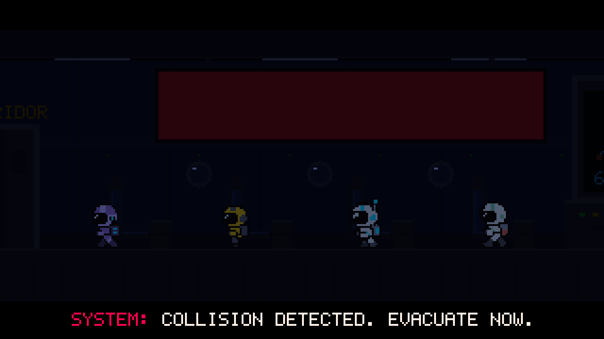
</p>
<p align="center"><sub>The opening film is drawn live by the game engine, not played from a video file.</sub></p>

## Talk to your crew

Press a key (or a controller button) and **speak**. Your crewmates hear you, understand you, and answer in their own voices.

| | Who | How they help |
|---|---|---|
| 🧑‍🚀 | **Aaron**, researcher | Your hands. He lifts, fetches, carries, holds switches and reads labels in the medkit. |
| 🔧 | **Dhan**, engineer | Your brain. He can't walk, but he knows every fuse box, fault code and setting on the ship. |
| 🖥️ | **M.A.R.V.I.S.**, ship computer | Ship status, the alarms, what still works and what doesn't. |

You don't use fixed commands. Say *"can you get that locker off him?"* or *"which fuse do I need for E-6?"* and the crew work it out. They only know what they've actually seen or been told, so you have to read Dhan the code on the panel before he can help with it.

<p align="center">
  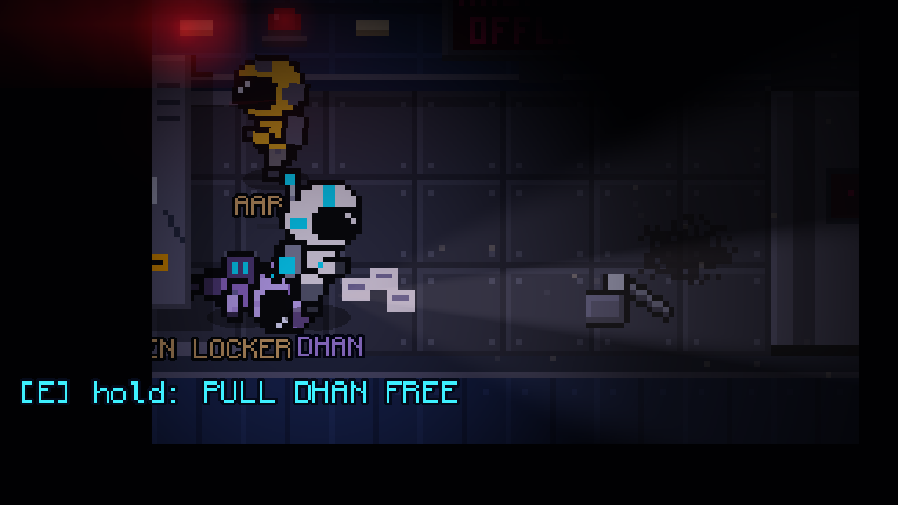
  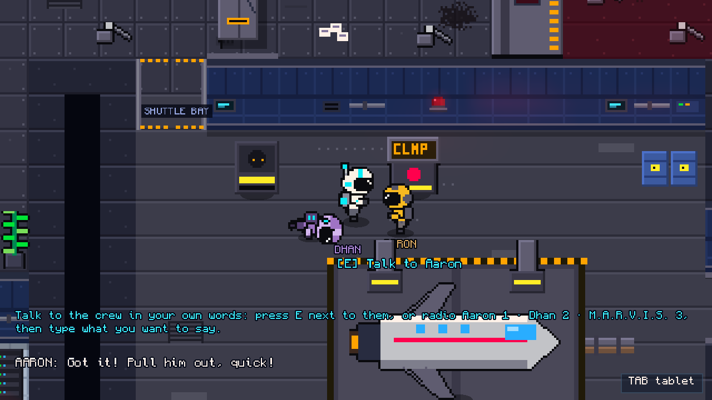
</p>

## How it plays

**Free Dhan.** Ask Aaron to lift the locker, then hold E to pull Dhan out before Aaron's grip gives out.

**Power the shuttle bay. Pick a route:**
- **Engineering:** isolate the power, read the fault code to Dhan, find the right fuse, trace the short, then press RESTART *while Aaron holds the bay breaker shut on the other side of the ship*. You can't be in two places at once, so timing it over the radio is the whole puzzle.
- **The lab battery:** faster, but unplugging it shuts off the freezer holding Kien's research. Save what you can first.

**Keep Dhan alive.** He's losing strength the whole time. Splint his leg in the medbay, and ask Aaron which medicine vial is the painkiller before you inject the wrong one.

**Launch.** Carry Dhan aboard, take the pilot seat, hold the thrusters while Aaron releases the clamps on your mark, and go.

The puzzle answers change every run, so you can't memorize them. You have to talk.

<p align="center">
  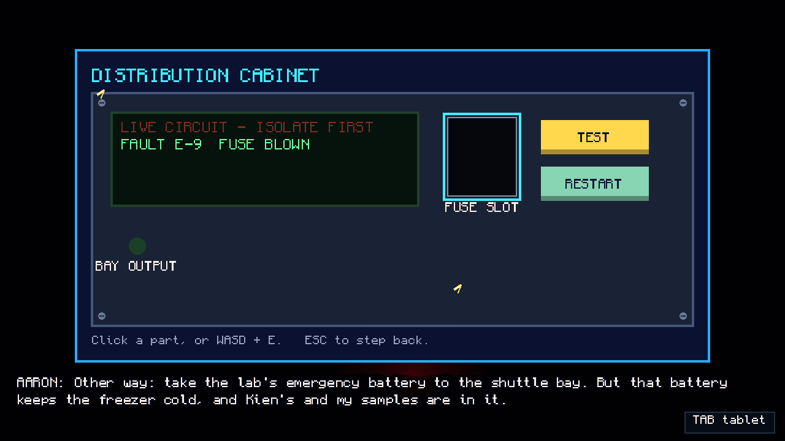
  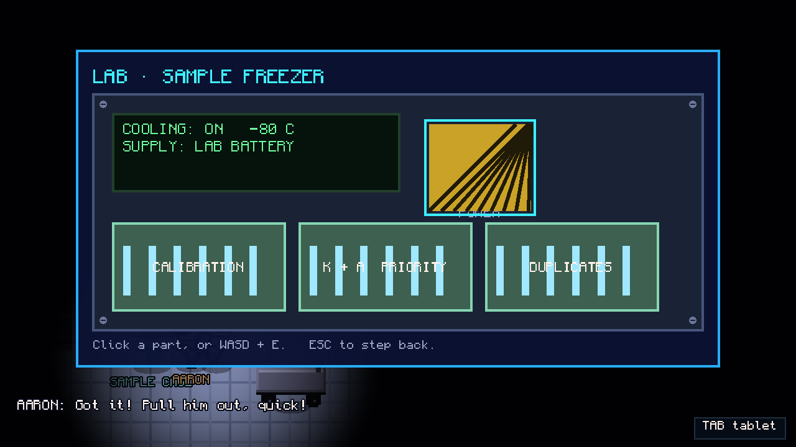
  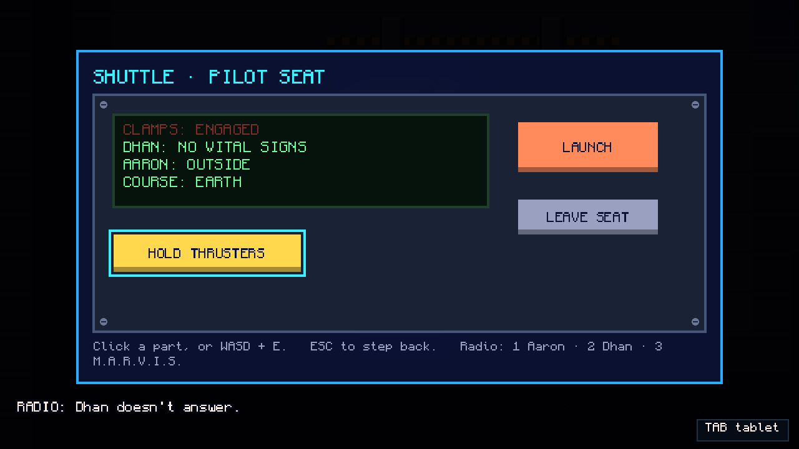
</p>
<p align="center">
  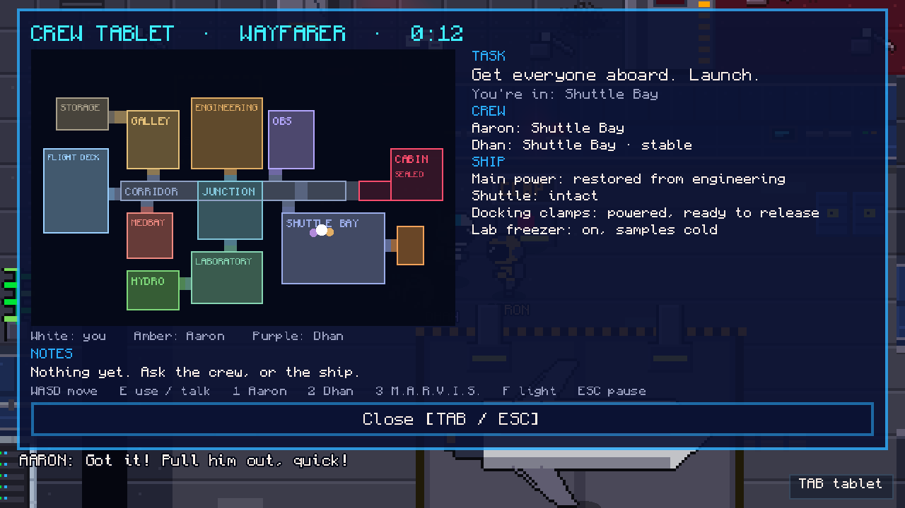
  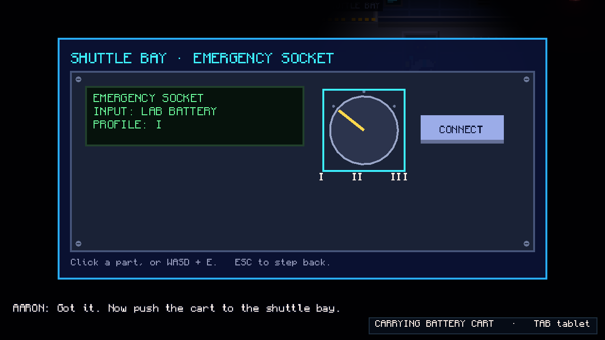
</p>
<p align="center"><sub>Machine close-ups, and the crew tablet (Tab / LT): your task, where everyone is, the ship's status and your notes.</sub></p>

## Five endings, five ways to fail

Who makes it home, and what comes with them, depends on your choices: **Everyone Home**, **What He Left**, **We Kept Each Other**, **Two Came Home** and **Barely**.

Get careless and the ship lets you know: touch a live cabinet, open the wrong airlock, or launch with the clamps on. Each fail rewinds you with a title card, and the game keeps track of every ending and fail you've found.

<p align="center">
  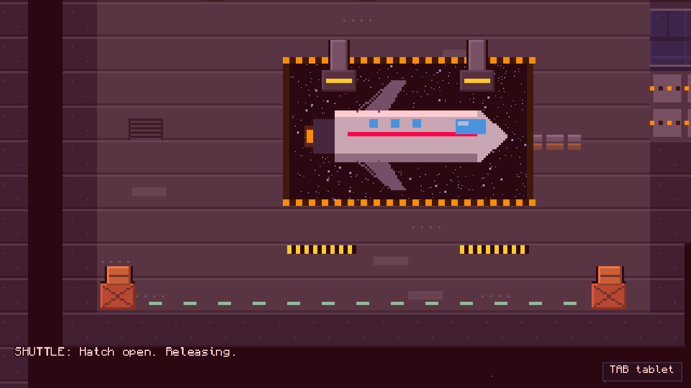
  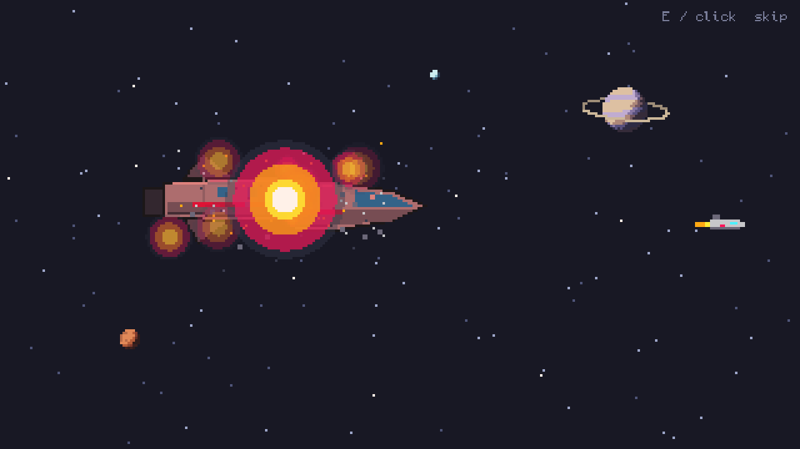
</p>
<p align="center">
  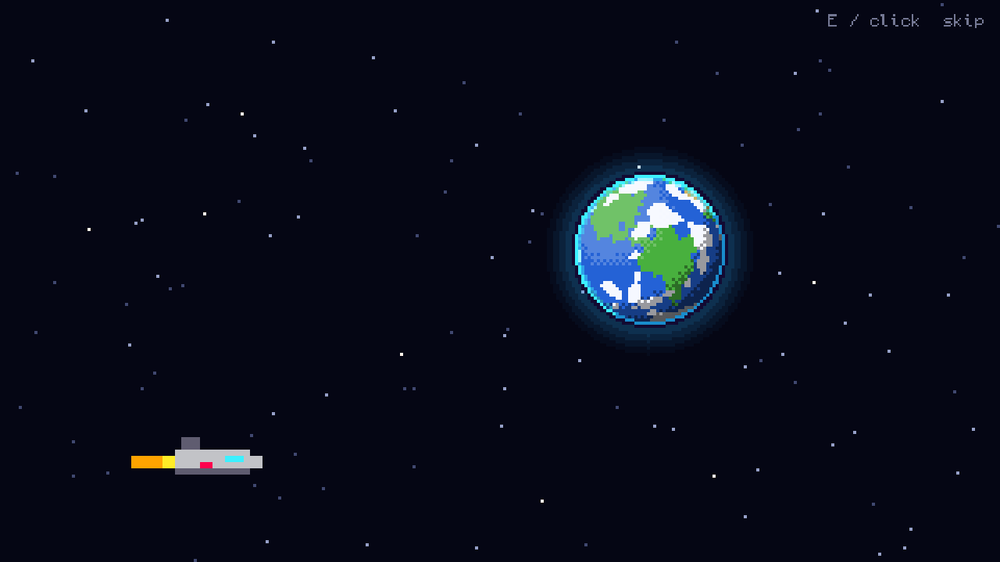
  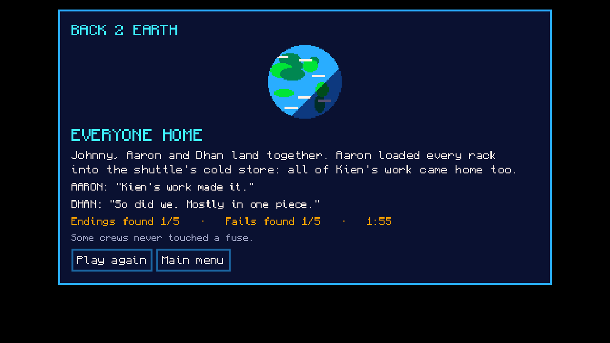
  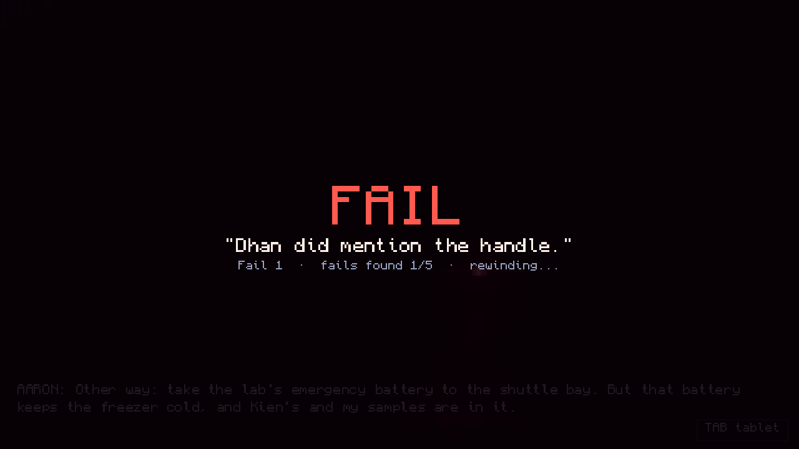
</p>
<p align="center"><sub>The ending film changes its dialogue and voices to match how your run went.</sub></p>

## Controls

| | Keyboard | Controller |
|---|---|---|
| Move | WASD | Left stick |
| Use / talk to someone nearby | E (hold for heavy jobs) | A |
| Radio Aaron / Dhan / M.A.R.V.I.S. | 1 / 2 / 3 | LB / RB / RT |
| Talk again (voice chat) | Space | X |
| Flashlight | F | Y |
| Crew tablet | Tab | LT |
| Pause | Esc | Start |
| Fullscreen | F11 or the pause menu | Pause menu |

In machine close-ups, click the parts, or move with WASD / the D-pad and press E / A. Voice chat uses your mic on keyboard and controller alike. Where speech isn't available, you can type instead.

---

## How it's built

<p align="center">
  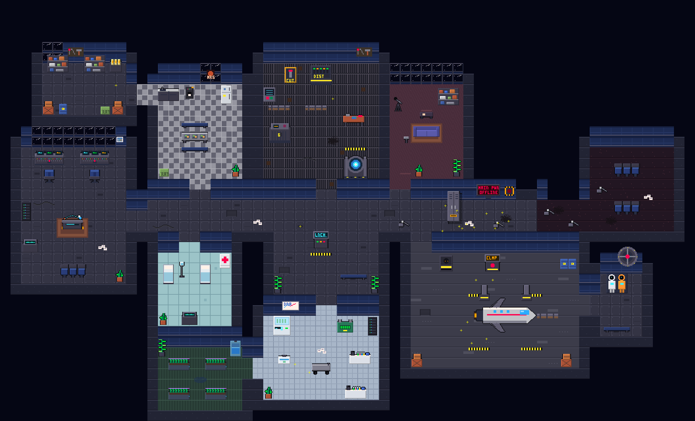
</p>
<p align="center"><sub>The whole <i>Wayfarer</i>: 14 rooms built from our own tiles and sprites.</sub></p>

```
Godot web build (GDScript)  ──►  Python companion server  ──►  Google Gemini   (what the crew says)
   rules, puzzles, saves         prompts · guardrails · rate limits  ElevenLabs  (how it sounds)
   Web Speech API (your voice)   accounts · cloud saves              PostgreSQL  (accounts, saves, leaderboard)
```

- **The game decides what's true, the AI only talks.** A rules engine ([`escape_state.gd`](scripts/prototype/escape_state.gd)) owns every puzzle answer and flag. Gemini can only *propose* an action from the list the game offers at that moment, and the game re-checks it before anything happens. A crewmate can't skip a puzzle by being talked into it.
- **No made-up facts.** Each request carries exactly what that crewmate has seen or been told. If you haven't read Dhan the fault code, he says he needs it instead of guessing.
- **Works offline.** If the server or the API goes down, a scripted interpreter takes over, so every story step can still be finished.
- **Speech made for a noisy room:** noise-suppressed mic input, several guesses per phrase ranked against game words, crew-name correction, NATO letters ("echo six") and an echo guard so the mic ignores the crew's own voices.
- **Voices:** 150+ scripted lines are pre-recorded with ElevenLabs. Live replies are spoken on the fly and cached on the server.
- **Cutscenes are code, not video.** The intro and ending films are drawn frame by frame at 320×180 and scaled up, kept in sync with the voice track, and the ending changes with your run.
- **Saves:** guest saves stay on the device. Accounts sync to the cloud with revision checks, and each save keeps its own crew memory, so starting a new game really does start fresh.
- **Hosting:** Caddy and Cloudflare on an Oracle Cloud VM. Every push to `main` builds and deploys the web version through GitHub Actions.

## Run it yourself

**The game:** install [Godot 4.7.2](https://godotengine.org) (standard build), import `project.godot` and press F5. The game runs fully offline with scripted crew replies.

**The AI backend** (Python 3.10+, no packages needed):

```bash
python3 server/companion_server.py              # mock mode: no keys, no cost
export GEMINI_API_KEY=...                        # live crew replies
export ELEVENLABS_API_KEY=...                    # live crew voices
python3 server/companion_server.py              # live mode on 127.0.0.1:8787
```

API keys stay in the server's environment only. Never put them in the game, the repo or a build.

**Tests:**

```bash
godot --headless --path . res://tests/escape_runner.tscn        # 1,000+ story, rules and scene checks
godot --headless --path . --script res://tests/intro_runner.gd  # intro film timing
python3 -m unittest server/test_escape_dialogue.py server/test_companion_server.py server/test_game_db.py
```

## More docs

- [Game Design](docs/Game%20Design.md): story, routes, numbers and every line
- [Escape build notes](docs/Escape%20Prototype.md): controls, walkthroughs (**spoilers**), live AI, recording voices, tests
- [Story Script](docs/Back2Earth%20Story%20Script.md): the opening film's script

## Team

**Johnny · Dhan · Kien · Aaron.** Yes, the crew are named after us.

<sub>Original pixel art by the team · Monocraft font by Idrees Hassan (SIL OFL 1.1) · royalty-free music and sound effects · crew voices by ElevenLabs · conversations by Google Gemini</sub>
